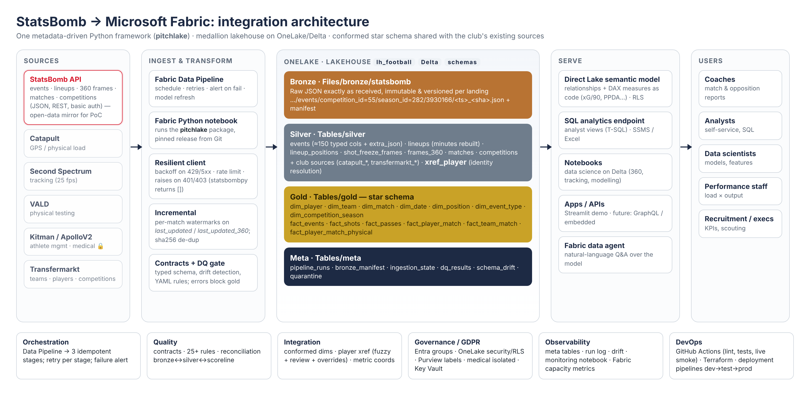

# pitchlake · StatsBomb → Microsoft Fabric lakehouse

**Integrating StatsBomb event data into a cloud sports-data platform — from API to Power BI.**
Built for the Middlesbrough FC *Data Engineer* interview task ("Integrating a New Data Source").

[](../../actions/workflows/ci.yml)



`pitchlake` is a small, metadata-driven Python framework that runs **unchanged on a laptop, in GitHub Actions and in
a Microsoft Fabric notebook**. It lands StatsBomb data immutably (bronze), flattens it against an explicit
contract (silver), resolves player identities against the club's other systems, gates on data quality, and
publishes a conformed **star schema** (gold) served through a **Direct Lake** semantic model.

| | |
|---|---|
| **Evaluate** | profiled every Euro 2024 event: 33 types, 151 JSON paths, 15 documented quirks → [source evaluation](docs/source_evaluation.md) |
| **Ingest** | resilient client, per-match watermarks (`last_updated`), immutable versioned bronze + manifest, sha256 de-dup |
| **Integrate** | conformed dims, player identity xref (Catapult/Transfermarkt) with review queue, metric coordinate conversion |
| **Serve** | 7 dims + 6 facts, Direct Lake model with DAX measures as code, T-SQL analyst views, Streamlit demo |
| **Trust** | typed contract + drift detection, 25 DQ rules (error = gate), reconciliation to the scoreline, full run log |
| **Operate** | Data Pipeline (3 idempotent stages, retries, alerts), CI (lint, 40 tests, live smoke), Terraform, deploy script |

Real findings from the data, caught by the framework: StatsBomb **revises matches years later**
(Euro 2024 updated in 2026), **extra-time lineups are chained in string order** (naive minutes = 286 for a
133-minute match), an **x = 120.1** coordinate, and **new fields** in older competitions (`pass.backheel`).

---

## Quick start (local, ~2 minutes)

```bash
git clone https://github.com/<GITHUB_USER>/mfc-statsbomb-lakehouse.git && cd mfc-statsbomb-lakehouse
python -m venv .venv && source .venv/bin/activate        # Windows: .venv\Scripts\activate
pip install -e ".[dev,app]"

pitchlake run --no-360                 # Euro 2024: bronze → silver → integrate → DQ → gold → DQ (~1 min)
pitchlake run                          # again: incremental, nothing changed → ~4 s, 2 HTTP calls
pitchlake status                       # run log, watermarks, landings, DQ, drift
streamlit run app/streamlit_app.py     # explore the gold layer
pytest                                 # 40 tests incl. offline end-to-end on real fixture data
```

Other scopes: `pitchlake run --scope 43:106` (World Cup 2022), `--scope 37:4 --max-matches 2` (FA WSL 2018/19 —
triggers the schema-drift demo).

## Run it on Microsoft Fabric

Import `fabric/notebooks/*.ipynb`, attach lakehouse `lh_football`, run `nb_01_run_pipeline`, then
`nb_02_semantic_model`. Step-by-step: **[docs/runbook_fabric.md](docs/runbook_fabric.md)**.
Automated: `python scripts/deploy_fabric.py --workspace-id <guid>` or `infra/terraform`.

## Repository map

```
src/pitchlake/            the framework (see docs/architecture.md)
  conf/                   pitchlake.yml · environments/{local,fabric,fabric-prod}.yml · dq_rules.yml · reference/
  gold/models/*.sql       the star schema, one SELECT per table
fabric/
  notebooks/              Fabric notebooks (generated by scripts/build_notebooks.py)
  pipeline/               Data Pipeline definition + build guide
  sql/analyst_views.sql   T-SQL views for the SQL analytics endpoint
infra/terraform/          workspace, lakehouse, notebooks, roles, Key Vault as code
app/streamlit_app.py      demo consumption app
tests/                    unit, offline end-to-end (real fixture data), live smoke
docs/                     evaluation · architecture · data model · dictionary · governance · ADRs · runbook · demo
presentation/             15-minute deck
```

## Documentation
* [Source evaluation](docs/source_evaluation.md) — what StatsBomb gives you, volumes, quirks, verdict
* [Architecture](docs/architecture.md) — layers, flow, framework, local vs Fabric, performance
* [Data model](docs/data_model.md) · [Data dictionary](docs/data_dictionary.md)
* [Governance, security & GDPR](docs/governance.md)
* [Decision records (ADRs)](docs/adr/README.md)
* [Assumptions, trade-offs & next steps](docs/assumptions_tradeoffs.md)
* [Fabric runbook & day-2 operations](docs/runbook_fabric.md)
* [Demo script](docs/demo_script.md)

## Data & licence
StatsBomb data © Hudl StatsBomb, used under the [StatsBomb Open Data](https://github.com/statsbomb/open-data)
user agreement. Data is never committed to this repo (test fixtures excepted, see `tests/fixtures/README.md`).
Catapult/Transfermarkt data in this project is **synthetic** and describes no real player.
Code: MIT.
