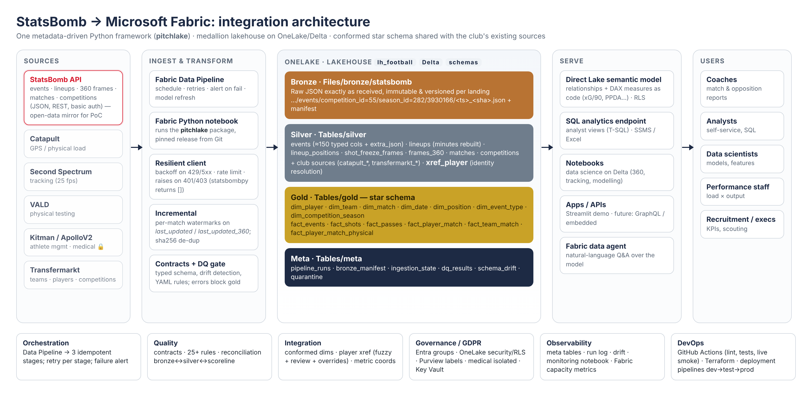
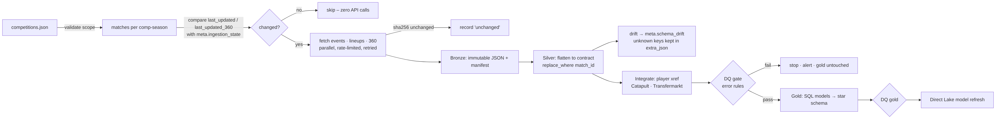
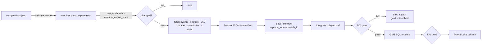

# Architecture



## Layers

| Layer | Storage | Contents | Write pattern | Owner |
|---|---|---|---|---|
| **Bronze** | `Files/bronze/statsbomb/…` (JSON) | exact vendor payloads, versioned per landing | append-only, immutable | pipeline |
| **Silver** | `Tables/silver.*` (Delta) | typed, contract-checked, one table per entity/child array; club sources; identity xref | atomic replace per match | pipeline |
| **Gold** | `Tables/gold.*` (Delta) | conformed star schema (7 dims, 6 facts) | full rebuild (seconds) | pipeline, reviewed SQL |
| **Meta** | `Tables/meta.*` (Delta) | run log, manifest, watermarks, DQ results, drift, quarantine | append / merge | pipeline |

## Flow





## Framework (`src/pitchlake`)

```
config.py          layered YAML: base <- environment <- runtime overrides (notebook params / CLI)
platform.py        Local vs Fabric: Files path, Delta table URI (abfss/OneLake + token), secrets (Key Vault)
tables.py          Delta IO: overwrite · replace_where · append · merge · optimize/vacuum (delta-rs)
sources/http.py    resilient HTTP: retries+jitter, Retry-After, rate limiter, raises on auth/4xx
sources/statsbomb.py   addressing for open-data and licensed API; API version drift check
sources/synthetic.py   SYNTHETIC Catapult/Transfermarkt extracts to prove integration
bronze.py          plan (watermarks) -> parallel fetch -> land immutable files -> manifest -> advance state
silver/contracts.py    the typed event contract + child table schemas
silver/flatten.py      pure JSON->rows functions (tested), minutes rebuild, drift capture
silver/build.py        per-match batches, atomic replace, drift log
integration/identity.py   player identity resolution (fuzzy + review + overrides)
gold/models/*.sql  star schema as ordered SQL models; gold/build.py runs them in DuckDB
quality/engine.py  YAML rules -> SQL -> meta.dq_results; enforce/warn gate
ops/               run log (meta.pipeline_runs), status report, JSON logging
pipeline.py / cli.py   one orchestration entry point for CLI, CI, notebooks, Streamlit
```

**Extending to a new source** (e.g. VALD): add a `sources/vald.py` adapter (address + fetch), a bronze landing
config, a silver contract + flattener, conform its athlete id through `xref_player`, add a gold fact on the existing
dimensions, add DQ rules. The orchestration, IO, logging, DQ and serving layers are reused unchanged.

## Same code, two platforms

| | Local / CI | Microsoft Fabric |
|---|---|---|
| Files | `./lakehouse/Files` | `/lakehouse/default/Files` (default-lakehouse mount) |
| Tables | `./lakehouse/Tables/<schema>/<table>` | `abfss://<ws>@onelake.dfs.fabric.microsoft.com/<lh>/Tables/<schema>/<table>` + bearer token |
| Secrets | env vars | Key Vault via `notebookutils.credentials.getSecret` |
| Orchestration | `pitchlake run` / GitHub Actions | Data Pipeline → `nb_01_run_pipeline` |
| Serving | Streamlit app | Direct Lake model, SQL endpoint, Power BI |

## Performance (measured, Euro 2024 incl. 360, single node)

| step | first load | steady-state incremental |
|---|---|---|
| bronze (153 files, 536 MB) | 26 s | 0.6 s (2 HTTP calls) |
| silver (188k events, 2.7 M 360 rows) | 46 s | 0 s (nothing pending) |
| integrate + DQ + gold + DQ | 3 s | 3 s |
| **total** | **≈ 75 s** | **≈ 4 s** |
