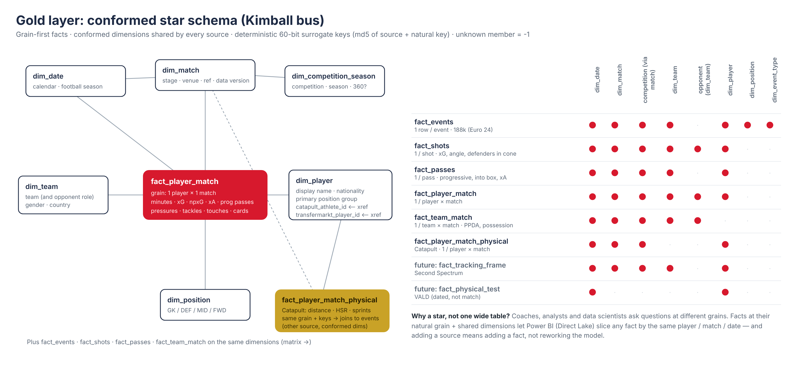
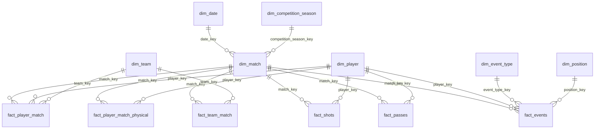

# Data model

Full column-level reference: [data_dictionary.md](data_dictionary.md).

## Facts and grains

| Fact | Grain | Key measures | Typical consumer |
|---|---|---|---|
| `fact_events` | one StatsBomb event | location (units + metres), outcome, xG | analysts, data science |
| `fact_shots` | one shot | xG, npxG, goal/on-target, distance, angle, **defenders in shot cone** (from freeze-frame), assist type | coaches, recruitment |
| `fact_passes` | one pass | complete, progressive, into final third/box, key pass, **xA** | analysts |
| `fact_player_match` | player × match | minutes (rebuilt), goals, xG, xA, progressive actions, pressures, tackles… | coaches, recruitment, execs |
| `fact_team_match` | team × match | goals, xG/xGA, possession %, **PPDA** | coaches, opposition analysis |
| `fact_player_match_physical` | player × match (Catapult) | distance, HSR, sprints, top speed, load | performance staff |

## Conformed dimensions
`dim_player` (with `catapult_athlete_id`, `transfermarkt_player_id` from the identity xref), `dim_team`,
`dim_match`, `dim_date` (with football season), `dim_competition_season`, `dim_position` (position groups),
`dim_event_type` (categories). Unknown member `-1` on every dimension.

## Metric definitions (agreed with analysts, single source in SQL/DAX)
* **Minutes played** — rebuilt from lineup stints in true time order, extra time included, shoot-out excluded.
* **npxG** — xG excluding penalties. **xA** — xG of the shot a pass directly assisted.
* **Progressive pass** — completed open-play pass from x ≥ 40 that ends ≥ 25 % closer to the centre of goal.
* **PPDA** — opponent open-play passes in their own 60 % ÷ our tackles + interceptions + fouls in that zone.
* **Possession %** — share of on-ball event duration by possession team.
* **Defenders in shot cone** — opponents (excl. GK) inside the triangle shot location → both posts.

## Star schema (Mermaid)

